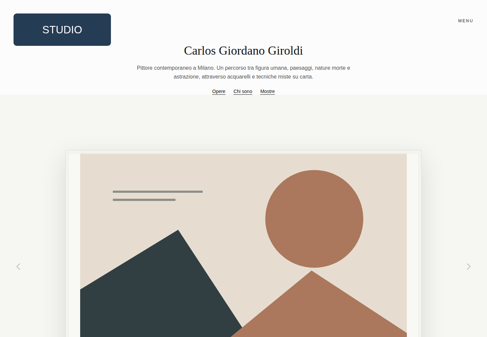

# Carlos Giordano — Artist Website

I developed an artist website with a bilingual gallery, exhibition archive, press section and contact pages.

[Live project](https://carlosgiordano.net) · Public portfolio edition



## Stack and features

React, TypeScript, Vite, React Router, Motion and Tailwind CSS.

- Typed artwork categories and image galleries
- Italian and English navigation with localized content
- Static page rendering and SEO metadata generation

## Run locally

Use Node.js 22 and npm:

```bash
npm ci
npm run dev
```

Open `http://localhost:3000/`. No account, service keys or environment configuration are required. Use fictional data when exploring forms.

## Public edition

The gallery uses fictional collections and repository-owned illustrations. Exhibition and press content are examples; the original artworks, photographs, reviews and videos are not included. The contact form never sends a request.

This repository starts from a separate source snapshot and contains no production Git history, hosting configuration, backups or operational reports. Public content and page structure are retained where useful; demo assets and sample contacts replace client materials. The live project runs from its separate private repository.

## Checks

```bash
npm run build
npm run lint
```

The CI workflow runs the build and TypeScript checks. Dependency update requests are configured through Dependabot. Production services are outside the scope of these checks.

## Assets

The SVG illustrations in this edition are simple geometric examples supplied with the source. Client artwork, photographs, membership documents and CV PDFs are not distributed. Third-party font licences are kept alongside the font files where used.
